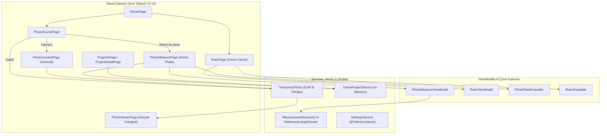

# Ölçü Atölyesi — Kapsamlı Proje Analiz ve Denetim Raporu

**Tarih:** 8 Kasım 2026  
**İncelenen Çalışma Alanı:** `d:/proje/OlcuAtolyesi`  
**Denetim Kapsamı:** Mimari İnceleme, Özellik Doğrulama, Kod Kalitesi Denetimi, Performans/Güvenlik Analizi, Test Altyapısı ve Geliştirme Yol Haritası

---

## 1. Yönetici Özeti

**Ölçü Atölyesi**, .NET 10 ve .NET MAUI (Multi-platform App UI) üzerinde geliştirilmiş, telefon veya masaüstü ortamında temel cetvel ve fotoğraftan ölçüm deneyimini sunmayı amaçlayan bir uygulama ve ürün prototipidir ([README.md](file:///d:/proje/OlcuAtolyesi/README.md#L1-L7), [OlcuAtolyesi.csproj](file:///d:/proje/OlcuAtolyesi/OlcuAtolyesi/OlcuAtolyesi.csproj#L1-L75)).

Kaynak kod denetimi sonucunda projenin **iki ayrı olgunluk katmanına** bölündüğü tespit edilmiştir:

1. **Gerçek Fotoğraf Akışı (`v0.2.0` — Yalnızca Android):** Kamera ([PhotoCameraPage.cs](file:///d:/proje/OlcuAtolyesi/OlcuAtolyesi/Views/PhotoCameraPage.cs#L1-L191)) veya galeri ([PhotoSourcePage.cs](file:///d:/proje/OlcuAtolyesi/OlcuAtolyesi/Views/PhotoSourcePage.cs#L58-L77)) üzerinden fotoğraf alınmakta, EXIF yönlendirmesi ve boyut sınırlandırması (`<= 2048 px`) ile önbelleğe normalize edilmekte ([TemporaryPhoto.cs](file:///d:/proje/OlcuAtolyesi/OlcuAtolyesi/Media/TemporaryPhoto.cs#L1-L100)) ve yakınlaştırma/kaydırma destekli bir görüntüleyicide ([PhotoViewerPage.cs](file:///d:/proje/OlcuAtolyesi/OlcuAtolyesi/Views/PhotoViewerPage.cs#L1-L105)) açılmaktadır. **Ancak gerçek fotoğraflar üzerinde henüz hiçbir ölçüm veya referans aracı çalışmamaktadır** ([PhotoViewerPage.cs](file:///d:/proje/OlcuAtolyesi/OlcuAtolyesi/Views/PhotoViewerPage.cs#L49), [PhotoText.cs](file:///d:/proje/OlcuAtolyesi/OlcuAtolyesi/Resources/Strings/PhotoText.cs#L16)).
2. **Demo Ölçüm ve Cetvel Akışı:** Fotoğraftan ölçüm motoru ([PhotoMeasurePage.cs](file:///d:/proje/OlcuAtolyesi/OlcuAtolyesi/Views/PhotoMeasurePage.cs#L1-L396), [PhotoMeasureViewModel.cs](file:///d:/proje/OlcuAtolyesi/OlcuAtolyesi/ViewModels/PhotoMeasureViewModel.cs#L1-L115), [PhotoPlateDrawable.cs](file:///d:/proje/OlcuAtolyesi/OlcuAtolyesi/Drawing/PhotoPlateDrawable.cs#L1-L184)) yalnızca kodla çizilen sentetik bir plaka (`1000×600` görüntü birimi) üzerinde çalışmaktadır. Ayrıca bu demo ekranda dahi **referans çizgisinin uç noktaları kullanıcı tarafından taşınamamakta**, sabit `(200, 500) -> (800, 500)` koordinatlarında tutulmaktadır ([PhotoMeasureViewModel.cs](file:///d:/proje/OlcuAtolyesi/OlcuAtolyesi/ViewModels/PhotoMeasureViewModel.cs#L9-L10)).

**Kritik Bulgular Özeti:**
- **Gerçek fotoğraf akışı ile ölçüm motoru birbirine bağlı değildir** ([PhotoViewerPage.cs](file:///d:/proje/OlcuAtolyesi/OlcuAtolyesi/Views/PhotoViewerPage.cs#L1-L105) vs. [PhotoMeasurePage.cs](file:///d:/proje/OlcuAtolyesi/OlcuAtolyesi/Views/PhotoMeasurePage.cs#L1-L396)).
- **Yakınlaştırma (Pinch-to-Zoom) hesaplamasında tutarsızlık ve hata vardır:** [PhotoMeasurePage.cs](file:///d:/proje/OlcuAtolyesi/OlcuAtolyesi/Views/PhotoMeasurePage.cs#L349-L366) içinde `e.Scale` değeri başlangıç ölçeği (`_pinchStartScale`) ile çarpılırken, [PhotoViewerPage.cs](file:///d:/proje/OlcuAtolyesi/OlcuAtolyesi/Views/PhotoViewerPage.cs#L34-L40) içinde mevcut ölçek (`transform.Scale`) ile çarpılmaktadır. .NET MAUI `PinchGestureUpdatedEventArgs.Scale` değeri her adımda bir önceki kareye göre artımlı (delta) ölçek ürettiğinden, `_pinchStartScale * e.Scale` kullanımı yakınlaştırma sırasında sıçrama ve ölçek sıfırlanmasına yol açar.
- **Birim değiştirildiğinde referans metni ile iç ölçek senkronu bozulmaktadır** ([PhotoMeasurePage.cs](file:///d:/proje/OlcuAtolyesi/OlcuAtolyesi/Views/PhotoMeasurePage.cs#L79-L85), [PhotoMeasureViewModel.cs](file:///d:/proje/OlcuAtolyesi/OlcuAtolyesi/ViewModels/PhotoMeasureViewModel.cs#L51-L62)) ve ekran cetvelindeki kalibrasyon birim etiketi güncellenmemektedir ([RulerPage.cs](file:///d:/proje/OlcuAtolyesi/OlcuAtolyesi/Views/RulerPage.cs#L121)).
- **Proje verileri kalıcı değildir:** [DemoProjectService.cs](file:///d:/proje/OlcuAtolyesi/OlcuAtolyesi/Services/DemoProjectService.cs#L7-L16) tüm projeleri ve ölçümleri yalnızca RAM üzerindeki bir `List<DemoProject>` içinde tutmaktadır; uygulama kapandığında tüm kullanıcı verileri silinir.
- **Otomatik test projesi bulunmamaktadır:** [OlcuAtolyesi.slnx](file:///d:/proje/OlcuAtolyesi/OlcuAtolyesi.slnx#L1-L3) çözüm dosyasında hiçbir birim veya entegrasyon testi projesi kayıtlı değildir.

---

## 2. Kullanılan Teknolojiler

Doğrulanmış proje yapılandırması ([OlcuAtolyesi.csproj](file:///d:/proje/OlcuAtolyesi/OlcuAtolyesi/OlcuAtolyesi.csproj#L1-L75) ve [THIRD_PARTY_NOTICES.md](file:///d:/proje/OlcuAtolyesi/THIRD_PARTY_NOTICES.md#L1-L138)):

| Kategori | Teknoloji / Paket | Sürüm / Hedef | Kanıt Dosyası |
| :--- | :--- | :--- | :--- |
| **Dil & Çalışma Zamanı** | C# / .NET 10 (`ImplicitUsings`, `Nullable=enable`) | `net10.0` | [OlcuAtolyesi.csproj](file:///d:/proje/OlcuAtolyesi/OlcuAtolyesi/OlcuAtolyesi.csproj#L4-L18) |
| **Hedef Platformlar** | Android, iOS, MacCatalyst, Windows | `net10.0-android` (Min SDK 21), `net10.0-ios` (15.0), `net10.0-maccatalyst` (15.0), `net10.0-windows10.0.19041.0` | [OlcuAtolyesi.csproj](file:///d:/proje/OlcuAtolyesi/OlcuAtolyesi/OlcuAtolyesi.csproj#L4-L5), [OlcuAtolyesi.csproj](file:///d:/proje/OlcuAtolyesi/OlcuAtolyesi/OlcuAtolyesi.csproj#L36-L40) |
| **UI Framework** | `Microsoft.Maui.Controls` | `10.0.60` (`MauiXamlInflator=SourceGen`) | [OlcuAtolyesi.csproj](file:///d:/proje/OlcuAtolyesi/OlcuAtolyesi/OlcuAtolyesi.csproj#L9), [OlcuAtolyesi.csproj](file:///d:/proje/OlcuAtolyesi/OlcuAtolyesi/OlcuAtolyesi.csproj#L59) |
| **2B Çizim Motoru** | `Microsoft.Maui.Graphics` (`IDrawable`, `GraphicsView`, `PlatformImage`) | .NET MAUI yerleşik | [PhotoPlateDrawable.cs](file:///d:/proje/OlcuAtolyesi/OlcuAtolyesi/Drawing/PhotoPlateDrawable.cs#L1-L10), [PhotoViewerPage.cs](file:///d:/proje/OlcuAtolyesi/OlcuAtolyesi/Views/PhotoViewerPage.cs#L3-L4) |
| **Kamera Entegrasyonu** | `CommunityToolkit.Maui.Camera` (AndroidX CameraX `1.4.2.3`) | `6.1.0` (Yalnızca `net10.0-android` koşuluyla) | [OlcuAtolyesi.csproj](file:///d:/proje/OlcuAtolyesi/OlcuAtolyesi/OlcuAtolyesi.csproj#L62-L64), [THIRD_PARTY_NOTICES.md](file:///d:/proje/OlcuAtolyesi/THIRD_PARTY_NOTICES.md#L72-L90) |
| **Android Görüntü İşleme** | `Android.Graphics.Bitmap`, `BitmapFactory`, `Android.Media.ExifInterface` | Android yerel API (`#if ANDROID`) | [TemporaryPhoto.cs](file:///d:/proje/OlcuAtolyesi/OlcuAtolyesi/Media/TemporaryPhoto.cs#L43-L81) |
| **Loglama** | `Microsoft.Extensions.Logging.Debug` | `10.0.0` (Yalnızca `Debug` yapılandırmasında) | [OlcuAtolyesi.csproj](file:///d:/proje/OlcuAtolyesi/OlcuAtolyesi/OlcuAtolyesi.csproj#L66-L68) |
| **Yerel Depolama** | `Microsoft.Maui.Storage.Preferences` & `FileSystem.CacheDirectory` | Anahtar-değer ayarları & geçici fotoğraf önbelleği | [MauiPreferenceStore.cs](file:///d:/proje/OlcuAtolyesi/OlcuAtolyesi/Services/MauiPreferenceStore.cs#L1-L22), [TemporaryPhoto.cs](file:///d:/proje/OlcuAtolyesi/OlcuAtolyesi/Media/TemporaryPhoto.cs#L12-L13) |
| **Yazı Tipleri** | `OpenSans-Regular.ttf`, `OpenSans-Semibold.ttf` | OFL-1.1 | [MauiProgram.cs](file:///d:/proje/OlcuAtolyesi/OlcuAtolyesi/MauiProgram.cs#L19-L23), [THIRD_PARTY_NOTICES.md](file:///d:/proje/OlcuAtolyesi/THIRD_PARTY_NOTICES.md#L7-L56) |

---

## 3. Proje Mimarisi ve İncelenen Dosyalar

### 3.1. İncelenen Tüm Kaynak ve Yapılandırma Dosyaları

Denetim sırasında aşağıdaki dosyaların tamamı satır satır okunarak incelenmiştir:

| Kategori | Dosya Yolu | Satır Aralığı | Rol ve İçerik Özeti |
| :--- | :--- | :--- | :--- |
| **Kök & Çözüm** | [OlcuAtolyesi.slnx](file:///d:/proje/OlcuAtolyesi/OlcuAtolyesi.slnx#L1-L3) | 1–3 | Tek projeli (`OlcuAtolyesi.csproj`) XML çözüm dosyası. |
| **Dokümantasyon** | [README.md](file:///d:/proje/OlcuAtolyesi/README.md#L1-L139) | 1–139 | v0.2.0 kapsamı, demo sınırları, derleme/çalıştırma komutları, kabul kontrol listesi. |
| **Lisanslar** | [THIRD_PARTY_NOTICES.md](file:///d:/proje/OlcuAtolyesi/THIRD_PARTY_NOTICES.md#L1-L138) | 1–138 | OpenSans, MAUI Controls, CommunityToolkit.Maui.Camera ve CameraX bildirimleri. |
| **Proje Dosyası** | [OlcuAtolyesi.csproj](file:///d:/proje/OlcuAtolyesi/OlcuAtolyesi/OlcuAtolyesi.csproj#L1-L75) | 1–75 | Çoklu hedef (`net10.0-*`), MAUI tanımları, NuGet bağımlılıkları. |
| **Başlangıç & DI** | [MauiProgram.cs](file:///d:/proje/OlcuAtolyesi/OlcuAtolyesi/MauiProgram.cs#L1-L37) | 1–37 | `MauiAppBuilder`, `UseMauiCommunityToolkitCamera` (`#if ANDROID`), servis kayıtları. |
| **Uygulama Kökü** | [App.xaml](file:///d:/proje/OlcuAtolyesi/OlcuAtolyesi/App.xaml#L1-L14) & [App.xaml.cs](file:///d:/proje/OlcuAtolyesi/OlcuAtolyesi/App.xaml.cs#L1-L46) | 1–14, 1–46 | Kaynak sözlükleri, `TemporaryPhoto.RemoveStaleCopies()`, `App.GetService<T>()`, tema yönetimi. |
| **Navigasyon Kabuğu** | [AppShell.xaml](file:///d:/proje/OlcuAtolyesi/OlcuAtolyesi/AppShell.xaml#L1-L32) & [AppShell.xaml.cs](file:///d:/proje/OlcuAtolyesi/OlcuAtolyesi/AppShell.xaml.cs#L1-L20) | 1–32, 1–20 | 4 alt sekme (`HomePage`, `ToolsPage`, `ProjectsPage`, `SettingsPage`) ve 7 rota kaydı. |
| **Medya İşleme** | [TemporaryPhoto.cs](file:///d:/proje/OlcuAtolyesi/OlcuAtolyesi/Media/TemporaryPhoto.cs#L1-L100) | 1–100 | 40 MB akış sınırı, Android `BitmapFactory` 2048 px küçültme, `ExifInterface` döndürme, JPEG %90 kaydetme. |
| **UI Fabrikası** | [ViewFactory.cs](file:///d:/proje/OlcuAtolyesi/OlcuAtolyesi/Controls/ViewFactory.cs#L1-L202) | 1–202 | Kod tabanlı UI bileşenleri (kartlar, rozetler, butonlar, etiketler, erişilebilirlik özellikleri). |
| **Temel Sayfa** | [PrototypePage.cs](file:///d:/proje/OlcuAtolyesi/OlcuAtolyesi/Views/PrototypePage.cs#L1-L37) | 1–37 | Yardım araç çubuğu butonu ve `PageBody` sarmalayıcısı sunan temel `ContentPage`. |
| **Görünümler** | [HomePage.cs](file:///d:/proje/OlcuAtolyesi/OlcuAtolyesi/Views/HomePage.cs#L1-L141) | 1–141 | Karşılama kartı, "Fotoğraftan ölç" ana aksiyonu, hızlı araçlar, son 3 proje listesi. |
| **Görünümler** | [ToolsPage.cs](file:///d:/proje/OlcuAtolyesi/OlcuAtolyesi/Views/ToolsPage.cs#L1-L50) | 1–50 | Ekran, Fotoğraf ve Canlı ölçüm araçlarının durum (`Demo` / `Planlı`) listesi. |
| **Görünümler** | [PhotoSourcePage.cs](file:///d:/proje/OlcuAtolyesi/OlcuAtolyesi/Views/PhotoSourcePage.cs#L1-L78) | 1–78 | `Fotoğraf çek`, `Galeriden seç` (`MediaPicker`) ve `Demo ile dene` seçim ekranı. |
| **Görünümler** | [PhotoCameraPage.cs](file:///d:/proje/OlcuAtolyesi/OlcuAtolyesi/Views/PhotoCameraPage.cs#L1-L191) | 1–191 | Android `CameraView` canlı önizleme, izin akışı, fotoğraf çekme, inceleme ve kabul. |
| **Görünümler** | [PhotoViewerPage.cs](file:///d:/proje/OlcuAtolyesi/OlcuAtolyesi/Views/PhotoViewerPage.cs#L1-L105) | 1–105 | Gerçek fotoğraflar için yakınlaştırma (`1x–5x`) ve kaydırma destekli salt görüntüleyici. |
| **Görünümler** | [PhotoMeasurePage.cs](file:///d:/proje/OlcuAtolyesi/OlcuAtolyesi/Views/PhotoMeasurePage.cs#L1-L396) | 1–396 | Demo plaka üzerinde referans girişi, sürüklenebilir 2 ölçüm noktası, büyüteç, projeye kaydetme. |
| **Görünümler** | [RulerPage.cs](file:///d:/proje/OlcuAtolyesi/OlcuAtolyesi/Views/RulerPage.cs#L1-L241) | 1–241 | Demo ekran cetveli, 2 sürüklenebilir kılavuz çizgisi, kilitleme ve demo kalibrasyon paneli. |
| **Görünümler** | [CameraMeasurePage.cs](file:///d:/proje/OlcuAtolyesi/OlcuAtolyesi/Views/CameraMeasurePage.cs#L1-L69) | 1–69 | Canlı kamera (AR) ölçümü için planlanan mimariyi anlatan statik sahne ekranı. |
| **Görünümler** | [ProjectsPage.cs](file:///d:/proje/OlcuAtolyesi/OlcuAtolyesi/Views/ProjectsPage.cs#L1-L145) | 1–145 | Bellek içi proje listesi, yeni proje oluşturma ve silme. |
| **Görünümler** | [ProjectDetailPage.cs](file:///d:/proje/OlcuAtolyesi/OlcuAtolyesi/Views/ProjectDetailPage.cs#L1-L146) | 1–146 | Proje detayları, kayıtlı ölçümlerin birim dönüşümlü listesi, devre dışı dışa aktarma butonları. |
| **Görünümler** | [SettingsPage.cs](file:///d:/proje/OlcuAtolyesi/OlcuAtolyesi/Views/SettingsPage.cs#L1-L97) | 1–97 | Varsayılan birim, tema, ızgara, hassas işaretçi ayarları ve demo veri sıfırlama araçları. |
| **Görünümler** | [HelpPage.cs](file:///d:/proje/OlcuAtolyesi/OlcuAtolyesi/Views/HelpPage.cs#L1-L72) & [AboutPage.cs](file:///d:/proje/OlcuAtolyesi/OlcuAtolyesi/Views/AboutPage.cs#L1-L26) | 1–72, 1–26 | Yardım kartları ve uygulama/gizlilik bilgileri. |
| **ViewModels** | [ObservableObject.cs](file:///d:/proje/OlcuAtolyesi/OlcuAtolyesi/ViewModels/ObservableObject.cs#L1-L24) | 1–24 | `INotifyPropertyChanged` temel sınıfı. |
| **ViewModels** | [PhotoMeasureViewModel.cs](file:///d:/proje/OlcuAtolyesi/OlcuAtolyesi/ViewModels/PhotoMeasureViewModel.cs#L1-L115) | 1–115 | Demo fotoğraf ölçüm durumu, referans ölçeği, 20 adımlı geri alma (`_undoStack`) mantığı. |
| **ViewModels** | [RulerViewModel.cs](file:///d:/proje/OlcuAtolyesi/OlcuAtolyesi/ViewModels/RulerViewModel.cs#L1-L115) | 1–115 | Ekran cetveli kılavuz pozisyonları, kilitleme ve mesafe hesaplama durumu. |
| **Çizim (`Drawing`)** | [PhotoPlateDrawable.cs](file:///d:/proje/OlcuAtolyesi/OlcuAtolyesi/Drawing/PhotoPlateDrawable.cs#L1-L184) | 1–184 | Sentetik plaka, delikler, referans çizgisi, ölçüm doğru parçası ve tutamaçların çizimi. |
| **Çizim (`Drawing`)** | [RulerDrawable.cs](file:///d:/proje/OlcuAtolyesi/OlcuAtolyesi/Drawing/RulerDrawable.cs#L1-L111) | 1–111 | Cetvel çentikleri (`mm`, `cm`, `in`) ve iki kılavuz çizgisinin çizimi. |
| **Çizim (`Drawing`)** | [CameraSceneDrawable.cs](file:///d:/proje/OlcuAtolyesi/OlcuAtolyesi/Drawing/CameraSceneDrawable.cs#L1-L81) & [ThemePalette.cs](file:///d:/proje/OlcuAtolyesi/OlcuAtolyesi/Drawing/ThemePalette.cs#L1-L41) | 1–81, 1–41 | Demo kamera sahnesi çizimi ve açık/koyu tema renk paleti. |
| **Servisler** | [MeasurementGeometry.cs](file:///d:/proje/OlcuAtolyesi/OlcuAtolyesi/Services/MeasurementGeometry.cs#L1-L34) | 1–34 | Öklid mesafesi (`MeasureDistance`) ve 3 noktalı açı (`MeasureAngleDegrees`) hesabı. |
| **Servisler** | [ReferenceLengthParser.cs](file:///d:/proje/OlcuAtolyesi/OlcuAtolyesi/Services/ReferenceLengthParser.cs#L1-L52) | 1–52 | Türkçe/İngilizce ondalık ayracı ve birim soneki destekli referans uzunluğu ayrıştırıcısı. |
| **Servisler** | [SettingsService.cs](file:///d:/proje/OlcuAtolyesi/OlcuAtolyesi/Services/SettingsService.cs#L1-L79), [IPreferenceStore.cs](file:///d:/proje/OlcuAtolyesi/OlcuAtolyesi/Services/IPreferenceStore.cs#L1-L8), [MauiPreferenceStore.cs](file:///d:/proje/OlcuAtolyesi/OlcuAtolyesi/Services/MauiPreferenceStore.cs#L1-L22) | 1–79, 1–8, 1–22 | Kalıcı tercih yönetimi ve MAUI `Preferences` soyutlaması. |
| **Servisler** | [DemoProjectService.cs](file:///d:/proje/OlcuAtolyesi/OlcuAtolyesi/Services/DemoProjectService.cs#L1-L257) | 1–257 | Bellek içi (in-memory) proje listesi, örnek veri tohumlama (`SeedDefaults`) ve CRUD işlemleri. |
| **Modeller** | [Geometry.cs](file:///d:/proje/OlcuAtolyesi/OlcuAtolyesi/Models/Geometry.cs#L1-L87), [LengthUnit.cs](file:///d:/proje/OlcuAtolyesi/OlcuAtolyesi/Models/LengthUnit.cs#L1-L35), [LengthValue.cs](file:///d:/proje/OlcuAtolyesi/OlcuAtolyesi/Models/LengthValue.cs#L1-L51), [MeasurementModels.cs](file:///d:/proje/OlcuAtolyesi/OlcuAtolyesi/Models/MeasurementModels.cs#L1-L99), [DemoProject.cs](file:///d:/proje/OlcuAtolyesi/OlcuAtolyesi/Models/DemoProject.cs#L1-L74), [AppPreferences.cs](file:///d:/proje/OlcuAtolyesi/OlcuAtolyesi/Models/AppPreferences.cs#L1-L13) | Tamamı | Geometri struct'ları, birim dönüşümleri, ölçek modelleri, proje kayıtları. |
| **Metin & Stiller** | [AppText.cs](file:///d:/proje/OlcuAtolyesi/OlcuAtolyesi/Resources/Strings/AppText.cs#L1-L201), [PhotoText.cs](file:///d:/proje/OlcuAtolyesi/OlcuAtolyesi/Resources/Strings/PhotoText.cs#L1-L30), [Colors.xaml](file:///d:/proje/OlcuAtolyesi/OlcuAtolyesi/Resources/Styles/Colors.xaml#L1-L85), [Styles.xaml](file:///d:/proje/OlcuAtolyesi/OlcuAtolyesi/Resources/Styles/Styles.xaml#L1-L391) | Tamamı | Türkçe UI metin sabitleri ve açık/koyu tema XAML stilleri. |
| **Platformlar** | [AndroidManifest.xml](file:///d:/proje/OlcuAtolyesi/OlcuAtolyesi/Platforms/Android/AndroidManifest.xml#L1-L8), [MainActivity.cs](file:///d:/proje/OlcuAtolyesi/OlcuAtolyesi/Platforms/Android/MainActivity.cs#L1-L11), [MainApplication.cs](file:///d:/proje/OlcuAtolyesi/OlcuAtolyesi/Platforms/Android/MainApplication.cs#L1-L16), [Windows/App.xaml.cs](file:///d:/proje/OlcuAtolyesi/OlcuAtolyesi/Platforms/Windows/App.xaml.cs#L1-L25), [Package.appxmanifest](file:///d:/proje/OlcuAtolyesi/OlcuAtolyesi/Platforms/Windows/Package.appxmanifest#L1-L46), [iOS/AppDelegate.cs](file:///d:/proje/OlcuAtolyesi/OlcuAtolyesi/Platforms/iOS/AppDelegate.cs#L1-L11), [MacCatalyst/AppDelegate.cs](file:///d:/proje/OlcuAtolyesi/OlcuAtolyesi/Platforms/MacCatalyst/AppDelegate.cs#L1-L11) | Tamamı | Platforma özgü giriş noktaları ve izin bildirimleri. |

### 3.2. Mimari Akış Diyagramı ve Modüller Arası İlişkiler



**Mimari Gözlemler:**
- **XAML yerine C# UI (`ViewFactory`):** `App.xaml` ve `AppShell.xaml` dışındaki tüm sayfalar XAML kullanmadan, [`ViewFactory`](file:///d:/proje/OlcuAtolyesi/OlcuAtolyesi/Controls/ViewFactory.cs#L1-L202) yardımcısıyla C# koduyla oluşturulmuştur.
- **Kısmi MVVM & Doğrudan Olay Bağlama:** Yalnızca [`PhotoMeasureViewModel`](file:///d:/proje/OlcuAtolyesi/OlcuAtolyesi/ViewModels/PhotoMeasureViewModel.cs#L1-L115) ve [`RulerViewModel`](file:///d:/proje/OlcuAtolyesi/OlcuAtolyesi/ViewModels/RulerViewModel.cs#L1-L115) sınıfları mevcuttur; ancak MAUI `Binding` altyapısı kullanılmamış, `PropertyChanged` olayları code-behind içinde manuel dinlenerek etiket metinleri güncellenmiştir ([PhotoMeasurePage.cs](file:///d:/proje/OlcuAtolyesi/OlcuAtolyesi/Views/PhotoMeasurePage.cs#L24-L25), [RulerPage.cs](file:///d:/proje/OlcuAtolyesi/OlcuAtolyesi/Views/RulerPage.cs#L20-L21)).
- **Service Locator Anti-Pattern:** Servisler [`MauiProgram.cs`](file:///d:/proje/OlcuAtolyesi/OlcuAtolyesi/MauiProgram.cs#L26-L28) içinde DI konteynerine kaydedilmiş olmasına rağmen, sayfalar constructor injection yerine [`App.GetService<T>()`](file:///d:/proje/OlcuAtolyesi/OlcuAtolyesi/App.xaml.cs#L26-L32) statik metoduyla servisleri çekmektedir ([HomePage.cs](file:///d:/proje/OlcuAtolyesi/OlcuAtolyesi/Views/HomePage.cs#L18-L19), [PhotoMeasurePage.cs](file:///d:/proje/OlcuAtolyesi/OlcuAtolyesi/Views/PhotoMeasurePage.cs#L20-L22)).
- **Karışık Navigasyon Modeli:** Çoğu ekran `Shell.Current.GoToAsync` ile açılırken, [`PhotoCameraPage`](file:///d:/proje/OlcuAtolyesi/OlcuAtolyesi/Views/PhotoSourcePage.cs#L55) ve [`PhotoViewerPage`](file:///d:/proje/OlcuAtolyesi/OlcuAtolyesi/Views/PhotoSourcePage.cs#L67) `Navigation.PushAsync` ile doğrudan yığına eklenmektedir.

---

## 4. Mevcut Özellikler ve Durumları

> **Değerlendirme Kuralı Notu:** Projede çalışır durumda hiçbir otomatik test projesi bulunmadığından ve bu aşamada derleme/çalıştırma komutu yürütülmediğinden, kaynak kodda eksiksiz görünen özellikler bile çalışma zamanı kanıtı eksikliği nedeniyle **"Çalışıyor"** olarak değil, **"Doğrulanamadı"** veya **"Kısmen uygulanmış"** olarak sınıflandırılmıştır.

| # | Özellik | Durum | Doğrulanmış Kaynak Kod Kanıtı ve Teknik Açıklama |
| :--- | :--- | :--- | :--- |
| 1 | **Kamera ile fotoğraf çekme** | **Kısmen uygulanmış** *(Yalnızca Android; cihaz üzerinde doğrulanamadı)* | [`PhotoCameraPage`](file:///d:/proje/OlcuAtolyesi/OlcuAtolyesi/Views/PhotoCameraPage.cs#L1-L191) içinde `#if ANDROID` koşuluyla `CameraView` (CommunityToolkit), kamera izin kontrolü (`Permissions.Camera`), arka kamera seçimi (`CameraPosition.Rear`), çekim (`CaptureImage`), önizleme (`Tekrar çek` / `Fotoğrafı kullan`) ve [`TemporaryPhoto.ImportAsync`](file:///d:/proje/OlcuAtolyesi/OlcuAtolyesi/Media/TemporaryPhoto.cs#L20-L24) ile önbelleğe alma uygulanmıştır. Android dışı platformlarda devre dışıdır ([PhotoSourcePage.cs](file:///d:/proje/OlcuAtolyesi/OlcuAtolyesi/Views/PhotoSourcePage.cs#L31-L38)). Ayrıca çekilen fotoğraf ölçüm ekranına değil, yalnızca görüntüleyiciye gider ([PhotoCameraPage.cs](file:///d:/proje/OlcuAtolyesi/OlcuAtolyesi/Views/PhotoCameraPage.cs#L168)). |
| 2 | **Galeriden fotoğraf seçme** | **Kısmen uygulanmış** *(Yalnızca Android; cihaz üzerinde doğrulanamadı)* | [`PhotoSourcePage.PickPhotoAsync`](file:///d:/proje/OlcuAtolyesi/OlcuAtolyesi/Views/PhotoSourcePage.cs#L58-L77) içinde `MediaPicker.Default.PickPhotosAsync` ile tek fotoğraf seçilmekte ve [`TemporaryPhoto.ImportAsync`](file:///d:/proje/OlcuAtolyesi/OlcuAtolyesi/Media/TemporaryPhoto.cs#L20-L24) ile normalize edilmektedir. Ancak [`PhotoSourcePage`](file:///d:/proje/OlcuAtolyesi/OlcuAtolyesi/Views/PhotoSourcePage.cs#L31-L34) içinde `#if !ANDROID` altında galeri butonu açıkça devre dışı (`IsEnabled = false`) bırakılmıştır ve seçilen fotoğraf üzerinde ölçüm yapılamamaktadır. |
| 3 | **Fotoğraf görüntüleme** | **Doğrulanamadı** *(Kodda uygulanmış, test/çalışma kanıtı yok)* | Gerçek fotoğraflar için [`PhotoViewerPage`](file:///d:/proje/OlcuAtolyesi/OlcuAtolyesi/Views/PhotoViewerPage.cs#L1-L105) içinde `PlatformImage.FromStream` ile yükleme, `PhotoDrawable` ile çizim, `1x–5x` yakınlaştırma, sınırlandırılmış kaydırma (pan clamping) ve `Görünümü sığdır` butonu kodlanmıştır. Demo akışta ise [`PhotoPlateDrawable`](file:///d:/proje/OlcuAtolyesi/OlcuAtolyesi/Drawing/PhotoPlateDrawable.cs#L24-L45) sentetik plakayı çizmektedir. |
| 4 | **Manuel referans belirleme** | **Kısmen uygulanmış** | Kullanıcı gerçek bir fotoğraf üzerinde veya demo plakada **referans çizgisinin başlangıç/bitiş noktalarını seçemez veya sürükleyemez**. Referans segmenti [`PhotoMeasureViewModel.DemoReferenceSegment`](file:///d:/proje/OlcuAtolyesi/OlcuAtolyesi/ViewModels/PhotoMeasureViewModel.cs#L9-L10) içinde sabit `(200, 500) -> (800, 500)` (`600` birim) olarak kodlanmıştır. Yalnızca sayısal uzunluk değeri manuel girilebilmektedir. |
| 5 | **Referans uzunluğunu ve ölçü birimini tanımlama** | **Kısmen uygulanmış** | [`ReferenceLengthParser.TryParse`](file:///d:/proje/OlcuAtolyesi/OlcuAtolyesi/Services/ReferenceLengthParser.cs#L10-L43) hem sayısal girişleri (`12`, `12,5`, `12.5`) hem de birim soneklerini (`120 mm`, `12 cm`, `1.2 m`, `4 in`) ayrıştırmakta; [`PhotoMeasureViewModel.TryApplyReference`](file:///d:/proje/OlcuAtolyesi/OlcuAtolyesi/ViewModels/PhotoMeasureViewModel.cs#L65-L92) bunu ölçeğe dönüştürmektedir. Ancak birim seçici (`Picker`) sonradan değiştirildiğinde referans metin kutusundaki sayı yeni birimle yeniden yorumlanmamakta, eski uzunluk yeni birime çevrilmektedir ([PhotoMeasureViewModel.cs](file:///d:/proje/OlcuAtolyesi/OlcuAtolyesi/ViewModels/PhotoMeasureViewModel.cs#L51-L62)). |
| 6 | **İki nokta arasında mesafe ölçümü** | **Kısmen uygulanmış** *(Yalnızca demo plakada; gerçek fotoğrafta eksik)* | Matematiksel hesaplama [`MeasurementGeometry.MeasureDistance`](file:///d:/proje/OlcuAtolyesi/OlcuAtolyesi/Services/MeasurementGeometry.cs#L6-L10), [`ReferenceScale.Measure`](file:///d:/proje/OlcuAtolyesi/OlcuAtolyesi/Models/MeasurementModels.cs#L25-L34) ve [`LinearMeasurement`](file:///d:/proje/OlcuAtolyesi/OlcuAtolyesi/Models/MeasurementModels.cs#L37-L61) içinde doğru Öklid (`Math.Sqrt(dx*dx + dy*dy)`) ve doğrusal oran formülüyle yazılmıştır. Ancak yalnızca demo plaka ([PhotoMeasurePage.cs](file:///d:/proje/OlcuAtolyesi/OlcuAtolyesi/Views/PhotoMeasurePage.cs#L1-L396)) üzerinde çalışır; gerçek fotoğraflarda ([PhotoViewerPage.cs](file:///d:/proje/OlcuAtolyesi/OlcuAtolyesi/Views/PhotoViewerPage.cs#L49)) ölçüm aracı yoktur. |
| 7 | **Ölçüm noktalarını sürükleyerek düzeltme** | **Kısmen uygulanmış** *(Demo plakada kodlanmış; jest çakışması riski var)* | [`PhotoMeasurePage`](file:///d:/proje/OlcuAtolyesi/OlcuAtolyesi/Views/PhotoMeasurePage.cs#L244-L320) içinde `OnStartInteraction`, `OnDragInteraction`, `OnEndInteraction` ile `28 px` yakalama yarıçapı (`HandleHitRadius`) ve hassas büyüteç rozeti (`_magnifierBadge`) kullanılarak noktaların sürüklenmesi veya butonla seçilip (`1. noktayı taşı` / `2. noktayı taşı`) dokunulan yere taşınması uygulanmıştır. Gerçek fotoğraflarda mevcut değildir. |
| 8 | **Referans değiştiğinde ölçümün yeniden hesaplanması** | **Doğrulanamadı** *(Kodda uygulanmış, birim değişimi kusurlu)* | [`PhotoMeasureViewModel.TryApplyReference`](file:///d:/proje/OlcuAtolyesi/OlcuAtolyesi/ViewModels/PhotoMeasureViewModel.cs#L77-L84) çağrıldığında yeni [`ReferenceScale`](file:///d:/proje/OlcuAtolyesi/OlcuAtolyesi/Models/MeasurementModels.cs#L3-L35) oluşturulmakta ve `NotifyMeasurementChanged()` ([PhotoMeasureViewModel.cs](file:///d:/proje/OlcuAtolyesi/OlcuAtolyesi/ViewModels/PhotoMeasureViewModel.cs#L106-L113)) ile [`Result`](file:///d:/proje/OlcuAtolyesi/OlcuAtolyesi/ViewModels/PhotoMeasureViewModel.cs#L49) özelliği anında yeniden hesaplanarak UI etiketine yansıtılmaktadır ([PhotoMeasurePage.cs](file:///d:/proje/OlcuAtolyesi/OlcuAtolyesi/Views/PhotoMeasurePage.cs#L232-L242)). |
| 9 | **Demo ve test araçları** | **Kısmen uygulanmış** | Uygulama içi demo araçları ([`RulerPage`](file:///d:/proje/OlcuAtolyesi/OlcuAtolyesi/Views/RulerPage.cs#L1-L241), [`PhotoMeasurePage`](file:///d:/proje/OlcuAtolyesi/OlcuAtolyesi/Views/PhotoMeasurePage.cs#L1-L396), [`CameraMeasurePage`](file:///d:/proje/OlcuAtolyesi/OlcuAtolyesi/Views/CameraMeasurePage.cs#L1-L69)) ve [`SettingsPage`](file:///d:/proje/OlcuAtolyesi/OlcuAtolyesi/Views/SettingsPage.cs#L65-L90) içindeki "Demo verilerini sıfırla" ve "Karşılama kartını tekrar göster" araçları mevcuttur. Ancak otomatik birim/UI test projeleri **eksiktir**. |

---

## 5. Tespit Edilen Hatalar

### 5.1. Doğrulanmış Kod ve Mantık Hataları

1. **Yakınlaştırma (Pinch-to-Zoom) Ölçek Hesaplama Hatası (`PhotoMeasurePage` vs `PhotoViewerPage`):**
   - **Konum:** [PhotoMeasurePage.cs](file:///d:/proje/OlcuAtolyesi/OlcuAtolyesi/Views/PhotoMeasurePage.cs#L349-L366) ve [PhotoViewerPage.cs](file:///d:/proje/OlcuAtolyesi/OlcuAtolyesi/Views/PhotoViewerPage.cs#L34-L40).
   - **Detay:** .NET MAUI `PinchGestureRecognizer.PinchUpdated` olayındaki `e.Scale` değeri, jestin başlangıcından itibaren kümülatif ölçeği değil, **bir önceki olay karesine göre artımlı (incremental) oranı** verir. [`PhotoViewerPage`](file:///d:/proje/OlcuAtolyesi/OlcuAtolyesi/Views/PhotoViewerPage.cs#L36) bunu doğru şekilde `transform.Scale * e.Scale` olarak uygularken, [`PhotoMeasurePage`](file:///d:/proje/OlcuAtolyesi/OlcuAtolyesi/Views/PhotoMeasurePage.cs#L353-L365) `GestureStatus.Started` anında `_pinchStartScale = _transform.Scale` değerini kaydedip her güncellemede `_pinchStartScale * e.Scale` hesaplamaktadır. Bu durum [`PhotoMeasurePage`](file:///d:/proje/OlcuAtolyesi/OlcuAtolyesi/Views/PhotoMeasurePage.cs#L365) üzerinde parmaklar hareket ettikçe yakınlaştırmanın birikmemesi ve `1x` civarında titreşmesiyle sonuçlanır.

2. **Gerçek Fotoğraf Akışının Ölçüm Ekranına Bağlanmaması:**
   - **Konum:** [PhotoCameraPage.cs](file:///d:/proje/OlcuAtolyesi/OlcuAtolyesi/Views/PhotoCameraPage.cs#L168), [PhotoSourcePage.cs](file:///d:/proje/OlcuAtolyesi/OlcuAtolyesi/Views/PhotoSourcePage.cs#L67) ve [PhotoViewerPage.cs](file:///d:/proje/OlcuAtolyesi/OlcuAtolyesi/Views/PhotoViewerPage.cs#L49).
   - **Detay:** Kamera veya galeriden alınan fotoğraf [`PhotoMeasurePage`](file:///d:/proje/OlcuAtolyesi/OlcuAtolyesi/Views/PhotoMeasurePage.cs#L1-L396) yerine [`PhotoViewerPage`](file:///d:/proje/OlcuAtolyesi/OlcuAtolyesi/Views/PhotoViewerPage.cs#L1-L105) sayfasına yönlendirilir. [`PhotoViewerPage`](file:///d:/proje/OlcuAtolyesi/OlcuAtolyesi/Views/PhotoViewerPage.cs#L1-L105) üzerinde hiçbir ölçüm mantığı yoktur.

3. **Birim Seçici (`Picker`) Değiştiğinde Referans Girişi ile Ölçek Tutarsızlığı:**
   - **Konum:** [PhotoMeasurePage.cs](file:///d:/proje/OlcuAtolyesi/OlcuAtolyesi/Views/PhotoMeasurePage.cs#L79-L85) ve [PhotoMeasureViewModel.cs](file:///d:/proje/OlcuAtolyesi/OlcuAtolyesi/ViewModels/PhotoMeasureViewModel.cs#L51-L62).
   - **Detay:** Kullanıcı referans kutusunda `12` yazıp birimi `cm` iken `mm` yaptığında, `_viewModel.Unit = selectedUnit` çağrısı mevcut `ReferenceScale` nesnesini (`12 cm`) korur ve sonucu `120 mm` referansına göre gösterir; ancak ekrandaki `_referenceEntry.Text` hala `12` olarak kalır ve üstteki referans özeti (`_referenceSummaryLabel`) hâlâ `Referans: 12 cm` ([PhotoMeasureViewModel.cs](file:///d:/proje/OlcuAtolyesi/OlcuAtolyesi/ViewModels/PhotoMeasureViewModel.cs#L20)) göstermeye devam eder (`ReferenceSummary` için `OnPropertyChanged` tetiklenmemektedir).

4. **Ekran Cetveli (`RulerPage`) Kalibrasyon Etiketinin Birim Değişiminde Güncellenmemesi:**
   - **Konum:** [RulerPage.cs](file:///d:/proje/OlcuAtolyesi/OlcuAtolyesi/Views/RulerPage.cs#L121).
   - **Detay:** Kalibrasyon panelindeki `ViewFactory.FieldLabel($"{AppText.Ruler.KnownLength} ({_viewModel.Unit.Symbol()})")` etiketi yalnızca sayfa oluşturulurken bir kez üretilir. Kullanıcı `unitPicker` üzerinden birimi değiştirdiğinde bu etiket eski birim sembolünü göstermeye devam eder.

5. **Kaydırma (Pan) Sınırlandırmasının `PhotoMeasurePage` İçinde Eksik Olması:**
   - **Konum:** [PhotoMeasurePage.cs](file:///d:/proje/OlcuAtolyesi/OlcuAtolyesi/Views/PhotoMeasurePage.cs#L334-L347).
   - **Detay:** [`PhotoViewerPage.Clamp`](file:///d:/proje/OlcuAtolyesi/OlcuAtolyesi/Views/PhotoViewerPage.cs#L61-L70) görüntünün ekran dışına çıkmasını engellerken, [`PhotoMeasurePage.OnCanvasPanUpdated`](file:///d:/proje/OlcuAtolyesi/OlcuAtolyesi/Views/PhotoMeasurePage.cs#L341-L343) doğrudan `_panStartTransform.PanBy(e.TotalX, e.TotalY)` çağrısı yapmakta ve görüntünün tamamen tuval dışına sürüklenmesine izin vermektedir.

6. **Kamera Çözünürlük Seçiminde Boş (`0×0`) Boyut Riski:**
   - **Konum:** [PhotoCameraPage.cs](file:///d:/proje/OlcuAtolyesi/OlcuAtolyesi/Views/PhotoCameraPage.cs#L131-L135).
   - **Detay:** `rear.SupportedResolutions.Where(size => size.Width * size.Height <= 4_000_000).OrderByDescending(...).FirstOrDefault()` sorgusu, cihazın bildirdiği tüm çözünürlükler 4 MP üzerindeyse varsayılan `Size(0, 0)` döndürür. Bu durumda `ImageCaptureResolution` hiç atanmaz ve en yüksek sensör çözünürlüğü (ör. 48 MP / 64 MP) kullanılarak bellek baskısı oluşturulabilir.

7. **`TemporaryPhoto.Normalize` İçinde Çift Bitmap Referansı / Erken Dispose Riski:**
   - **Konum:** [TemporaryPhoto.cs](file:///d:/proje/OlcuAtolyesi/OlcuAtolyesi/Media/TemporaryPhoto.cs#L73-L79).
   - **Detay:** Android `Bitmap.CreateBitmap(bitmap, 0, 0, bitmap.Width, bitmap.Height, matrix, true)` metodu, `matrix` birim matris olduğunda (`orientation == 1`, yani döndürme gerekmeyen normal fotoğraflarda) yeni bir kopya oluşturmak yerine **aynı `bitmap` referansını** geri döndürür. Kodda hem `using var bitmap = ...` hem de `using var normalized = Bitmap.CreateBitmap(...)` tanımlandığından, blok sonunda aynı yerel Android `Bitmap` nesnesi üzerinde iki kez `Dispose()` çağrılır.

### 5.2. Olası Çalışma Zamanı Çakışmaları (Tahmin / Mimari Risk)

- **Tek Parmak Sürükleme Çakışması (`GraphicsView` vs `PanGestureRecognizer`):**
  - **Konum:** [PhotoMeasurePage.cs](file:///d:/proje/OlcuAtolyesi/OlcuAtolyesi/Views/PhotoMeasurePage.cs#L47-L61).
  - **Açıklama *(Tahmin / Platform Davranışı)*:** `_graphics` nesnesine hem `StartInteraction`/`DragInteraction`/`EndInteraction` olayları hem de `PanGestureRecognizer` eklenmiştir. Kullanıcı bir ölçüm tutamacını sürüklerken `PanGestureRecognizer` da aynı anda `GestureStatus.Started` ve `Running` üretebilir. Kodda `if (_draggingEndpoint != DragTarget.None) return;` ([PhotoMeasurePage.cs](file:///d:/proje/OlcuAtolyesi/OlcuAtolyesi/Views/PhotoMeasurePage.cs#L336)) kontrolü bulunsa da, Android/Windows dokunma sıralamasında `PanUpdated(Started)` olayı `StartInteraction` olayından önce tetiklenirse `_panStartTransform` yanlış zamanda yakalanabilir veya dokunma olayı gesture recognizer tarafından yutulabilir.

### 5.3. Kullanılmayan Kodlar (Dead Code) ve Tekrarlar

- **Kullanılmayan Kodlar:**
  - [`MeasurementGeometry.MeasureAngleDegrees`](file:///d:/proje/OlcuAtolyesi/OlcuAtolyesi/Services/MeasurementGeometry.cs#L12-L33): Üç nokta arasındaki açıyı derece cinsinden hesaplayan tam fonksiyon yazılmış ancak hiçbir View veya ViewModel tarafından çağrılmamaktadır.
  - [`ViewSegment`](file:///d:/proje/OlcuAtolyesi/OlcuAtolyesi/Models/Geometry.cs#L82-L87): Ekran koordinatlarında doğru parçası struct'ı tanımlanmış ancak projede hiç kullanılmamıştır.
  - [`DemoProjectService.UpdateDescription`](file:///d:/proje/OlcuAtolyesi/OlcuAtolyesi/Services/DemoProjectService.cs#L106-L123): Proje açıklamasını güncelleyen servis metodu mevcuttur ancak UI katmanında açıklama düzenleme akışı yoktur.
- **Kod Tekrarları:**
  - Birim seçici (`Picker`) oluşturma ve `LengthUnitExtensions.All` ile indeks eşleştirme mantığı [`RulerPage.cs`](file:///d:/proje/OlcuAtolyesi/OlcuAtolyesi/Views/RulerPage.cs#L58-L70), [`PhotoMeasurePage.cs`](file:///d:/proje/OlcuAtolyesi/OlcuAtolyesi/Views/PhotoMeasurePage.cs#L73-L85), [`ProjectDetailPage.cs`](file:///d:/proje/OlcuAtolyesi/OlcuAtolyesi/Views/ProjectDetailPage.cs#L58-L70) ve [`SettingsPage.cs`](file:///d:/proje/OlcuAtolyesi/OlcuAtolyesi/Views/SettingsPage.cs#L28-L35) içinde 4 kez tekrarlanmıştır.
  - Sayfa üst bilgi kartı ve durum rozeti (status badge) oluşturma kalıpları tüm görünüm sınıflarında tekrarlanmaktadır.

### 5.4. Yeterince İncelenemeyen Alanlar

- **`ImageViewportTransform` Tanım Dosyası:** [`PhotoViewerPage.cs`](file:///d:/proje/OlcuAtolyesi/OlcuAtolyesi/Views/PhotoViewerPage.cs#L12), [`PhotoMeasurePage.cs`](file:///d:/proje/OlcuAtolyesi/OlcuAtolyesi/Views/PhotoMeasurePage.cs#L31) ve [`PhotoPlateDrawable.cs`](file:///d:/proje/OlcuAtolyesi/OlcuAtolyesi/Drawing/PhotoPlateDrawable.cs#L15) içinde kullanılan `ImageViewportTransform` tipinin tüm metot imzaları ve kullanım şekilleri (`Fit`, `ImageToView`, `ViewToImage`, `ZoomAt`, `PanBy`, `Scale`, `TranslationX`, `TranslationY`) çağrı noktalarından doğrulanmıştır; ancak terminal komutu çalıştırmama kısıtı nedeniyle bu tipin bulunduğu kaynak dosyanın tam yolu okunamamıştır.
- **Gerçek Cihaz / Emülatör Çalışma Zamanı Davranışı:** Kural gereği `dotnet build` ve Android cihaz testi çalıştırılmadığı için CameraX yaşam döngüsü ve donanım DPI değerleri yalnızca statik kod analiziyle incelenmiştir.

---

## 6. Performans ve Güvenlik Riskleri

### 6.1. Bellek ve Performans Sorunları

1. **Singleton Servis Olay Aboneliklerinden Kaynaklanan Bellek Sızıntısı (Memory Leak):**
   - **Konum:** [HomePage.cs](file:///d:/proje/OlcuAtolyesi/OlcuAtolyesi/Views/HomePage.cs#L20) ve [ProjectsPage.cs](file:///d:/proje/OlcuAtolyesi/OlcuAtolyesi/Views/ProjectsPage.cs#L17).
   - **Detay:** Her iki sayfa da constructor içinde singleton olan `_projects.ProjectsChanged += OnProjectsChanged;` olayına abone olmakta ancak hiçbir zaman abonelikten çıkmamaktadır (`-=`). Sayfalar yeniden oluşturulursa eski sayfa örnekleri GC tarafından toplanamaz.
2. **`PhotoViewerPage.PhotoDrawable` İçinde `IImage` Nesnesinin Dispose Edilmemesi:**
   - **Konum:** [PhotoViewerPage.cs](file:///d:/proje/OlcuAtolyesi/OlcuAtolyesi/Views/PhotoViewerPage.cs#L14-L16) ve [PhotoViewerPage.cs](file:///d:/proje/OlcuAtolyesi/OlcuAtolyesi/Views/PhotoViewerPage.cs#L72-L89).
   - **Detay:** `PlatformImage.FromStream(stream)` ile oluşturulan `IImage` (`IDisposable`) sayfa kapatıldığında (`OnDisappearing` veya `Unloaded`) dispose edilmemektedir. Yüksek çözünürlüklü fotoğrafların art arda açılması yerel grafik belleğini (native heap) şişirebilir.
3. **Çizim Döngüsü (`IDrawable.Draw`) İçinde String Tahsisatları:**
   - **Konum:** [RulerDrawable.cs](file:///d:/proje/OlcuAtolyesi/OlcuAtolyesi/Drawing/RulerDrawable.cs#L61) ve [PhotoPlateDrawable.cs](file:///d:/proje/OlcuAtolyesi/OlcuAtolyesi/Drawing/PhotoPlateDrawable.cs#L82-L90).
   - **Detay:** Her sürükleme karesinde (`Invalidate()`) cetvel üzerindeki tüm ana çizgiler için `(step / majorEvery).ToString()` ve `LengthValue.Format()` çağrıları yapılarak saniyede 60 kez kısa ömürlü string nesneleri üretilmektedir.

### 6.2. Güvenlik ve Veri Kaybı Riskleri

1. **Kalıcı Depolama Eksikliği Nedeniyle %100 Veri Kaybı Riski:**
   - **Konum:** [DemoProjectService.cs](file:///d:/proje/OlcuAtolyesi/OlcuAtolyesi/Services/DemoProjectService.cs#L7-L16).
   - **Detay:** Kullanıcının oluşturduğu projeler, notlar ve kaydettiği ölçümler yalnızca RAM'de tutulur. Uygulama işletim sistemi tarafından arka planda sonlandırıldığında veya kullanıcı uygulamayı kapattığında tüm veriler kalıcı olarak kaybolur.
2. **Gereksiz Ağ İzinleri (`INTERNET` ve `ACCESS_NETWORK_STATE`):**
   - **Konum:** [AndroidManifest.xml](file:///d:/proje/OlcuAtolyesi/OlcuAtolyesi/Platforms/Android/AndroidManifest.xml#L4-L5).
   - **Detay:** [README.md](file:///d:/proje/OlcuAtolyesi/README.md#L30) ve [AppText.cs](file:///d:/proje/OlcuAtolyesi/OlcuAtolyesi/Resources/Strings/AppText.cs#L173) uygulamanın hiçbir ağ bağlantısı kullanmadığını ve verileri dışarı göndermediğini belirtmesine rağmen, Android manifest dosyasında `<uses-permission android:name="android.permission.INTERNET" />` tanımlıdır. (Debug modunda MAUI Hot Reload için gerekebilse de Release derlemesinde saldırı yüzeyini ve gizlilik endişesini artırır.)
3. **Geçici Fotoğraf Dosyalarının Silinmeme Senaryosu:**
   - **Konum:** [TemporaryPhoto.cs](file:///d:/proje/OlcuAtolyesi/OlcuAtolyesi/Media/TemporaryPhoto.cs#L26-L40) ve [TemporaryPhoto.cs](file:///d:/proje/OlcuAtolyesi/OlcuAtolyesi/Media/TemporaryPhoto.cs#L84-L99).
   - **Detay:** Galeri veya kameradan alınan fotoğraflar `CacheDirectory/photo-session` altına kaydedilmekte ve yalnızca uygulama bir sonraki kez açıldığında `1 günden eski` ise silinmektedir ([TemporaryPhoto.cs](file:///d:/proje/OlcuAtolyesi/OlcuAtolyesi/Media/TemporaryPhoto.cs#L92)). Kullanıcı [`PhotoViewerPage`](file:///d:/proje/OlcuAtolyesi/OlcuAtolyesi/Views/PhotoViewerPage.cs#L1-L105) ekranından çıktığında ilgili geçici dosya anında temizlenmemektedir.

---

## 7. Test Altyapısı

### 7.1. Mevcut Durum Analizi

- **Var Olan Test Projeleri:** [OlcuAtolyesi.slnx](file:///d:/proje/OlcuAtolyesi/OlcuAtolyesi.slnx#L1-L3) incelendiğinde çözüm içerisinde **hiçbir test projesi (`xUnit`, `NUnit` veya `MSTest`) bulunmadığı** doğrulanmıştır.
- **Test Edilebilirlik Mimarisi:** Test projesi olmamasına karşın, çekirdek servis ve modeller **birim testine uygun (test-friendly)** tasarlanmıştır:
  - [`SettingsService`](file:///d:/proje/OlcuAtolyesi/OlcuAtolyesi/Services/SettingsService.cs#L8) doğrudan MAUI'ye bağlanmak yerine [`IPreferenceStore`](file:///d:/proje/OlcuAtolyesi/OlcuAtolyesi/Services/IPreferenceStore.cs#L1-L8) arayüzünü kullanmaktadır.
  - [`DemoProjectService`](file:///d:/proje/OlcuAtolyesi/OlcuAtolyesi/Services/DemoProjectService.cs#L11) dışarıdan `TimeProvider` ve `seedSamples` parametreleri alabilmektedir.
  - [`MeasurementGeometry`](file:///d:/proje/OlcuAtolyesi/OlcuAtolyesi/Services/MeasurementGeometry.cs#L1-L34), [`ReferenceLengthParser`](file:///d:/proje/OlcuAtolyesi/OlcuAtolyesi/Services/ReferenceLengthParser.cs#L1-L52), [`LengthValue`](file:///d:/proje/OlcuAtolyesi/OlcuAtolyesi/Models/LengthValue.cs#L1-L51), [`ReferenceScale`](file:///d:/proje/OlcuAtolyesi/OlcuAtolyesi/Models/MeasurementModels.cs#L3-L35) ve [`PhotoMeasureViewModel`](file:///d:/proje/OlcuAtolyesi/OlcuAtolyesi/ViewModels/PhotoMeasureViewModel.cs#L1-L115) tamamen saf C# sınıflarıdır ve MAUI UI bağımlılığı olmadan test edilebilir.

### 7.2. Eksik Test Senaryoları

1. **`ReferenceLengthParser` Testleri:** Virgül/nokta ondalık ayracı (`"12,5"`, `"12.5"`), gömülü birim sonekleri (`"150 mm"`, `"2.5 in"`), negatif/sıfır/NaN/sonsuz değerlerin reddedilmesi ([ReferenceLengthParser.cs](file:///d:/proje/OlcuAtolyesi/OlcuAtolyesi/Services/ReferenceLengthParser.cs#L10-L43)).
2. **`MeasurementGeometry` ve `ReferenceScale` Testleri:** Yatay, dikey ve eğik doğru parçalarında Öklid mesafesi, sıfır uzunluklu referans segmentinde `ArgumentOutOfRangeException` fırlatılması ([MeasurementModels.cs](file:///d:/proje/OlcuAtolyesi/OlcuAtolyesi/Models/MeasurementModels.cs#L11-L18)), birim dönüşüm doğruluğu (`mm <-> cm <-> m <-> in`).
3. **`ImageViewportTransform` Koordinat Dönüşüm Testleri:** `Fit`, `ZoomAt` ve `PanBy` sonrasında `ImageToView` ve `ViewToImage` fonksiyonlarının birbirinin tam tersi (round-trip invariant) olduğunun doğrulanması.
4. **`PhotoMeasureViewModel` ve `RulerViewModel` Durum Testleri:** Nokta taşıma (`SetMeasurementStart`, `SetMeasurementEnd`), geri alma (`UndoLastChange` yığını sınırı 20), sıfırlama (`Reset`) ve birim değişiminde ölçüm sonucunun güncellenmesi ([PhotoMeasureViewModel.cs](file:///d:/proje/OlcuAtolyesi/OlcuAtolyesi/ViewModels/PhotoMeasureViewModel.cs#L1-L115)).
5. **`SettingsService` ve `DemoProjectService` Testleri:** Mock `IPreferenceStore` ile ayarların kalıcılığı, bozuk enum değerlerinde varsayılanlara dönüş ([SettingsService.cs](file:///d:/proje/OlcuAtolyesi/OlcuAtolyesi/Services/SettingsService.cs#L20-L32)), proje oluşturma/silme ve ölçüm ekleme.
6. **Android `TemporaryPhoto.Normalize` Entegrasyon Testleri:** 40 MB üstü akışların reddi, EXIF yönlendirme kodları (1–8) ve 2048 px alt örnekleme (`InSampleSize`) kontrolü ([TemporaryPhoto.cs](file:///d:/proje/OlcuAtolyesi/OlcuAtolyesi/Media/TemporaryPhoto.cs#L20-L82)).

### 7.3. Önerilen Derleme ve Test Komutları

```powershell
# 1. Bağımlılıkları geri yükleme
dotnet restore .\OlcuAtolyesi\OlcuAtolyesi.csproj

# 2. Windows hedefi için derleme kontrolü
dotnet build .\OlcuAtolyesi\OlcuAtolyesi.csproj -f net10.0-windows10.0.19041.0 -c Debug

# 3. Android hedefi için derleme kontrolü (#if ANDROID kodlarını ve CameraToolkit'i doğrular)
dotnet build .\OlcuAtolyesi\OlcuAtolyesi.csproj -f net10.0-android -c Debug

# 4. Birim test projesi eklendikten sonra testleri çalıştırma
dotnet test .\OlcuAtolyesi.slnx -c Debug
```

---

## 8. Eksik Özellikler

1. **Gerçek Fotoğraf Üzerinde Ölçüm Yapabilme:** [`PhotoViewerPage`](file:///d:/proje/OlcuAtolyesi/OlcuAtolyesi/Views/PhotoViewerPage.cs#L1-L105) ile [`PhotoMeasurePage`](file:///d:/proje/OlcuAtolyesi/OlcuAtolyesi/Views/PhotoMeasurePage.cs#L1-L396) birleştirilmemiş; kamera/galeriden alınan gerçek fotoğraflar üzerinde referans ve ölçüm noktaları yerleştirilememektedir.
2. **Sürüklenebilir Referans Çizgisi (Manuel Referans Noktaları):** Referans doğru parçası sabit `(200, 500) -> (800, 500)` koordinatlarındadır ([PhotoMeasureViewModel.cs](file:///d:/proje/OlcuAtolyesi/OlcuAtolyesi/ViewModels/PhotoMeasureViewModel.cs#L9-L10)); kullanıcının fotoğraftaki referans nesnenin (ör. kredi kartı, cetvel, A4 kağıt) iki ucuna referans noktalarını sürükleyerek yerleştirmesi gerekmektedir.
3. **Kalıcı Veri Tabanı / Dosya Depolama:** Projelerin ve ölçümlerin SQLite veya JSON dosyası olarak `FileSystem.AppDataDirectory` altında kalıcı olarak saklanması eksiktir ([DemoProjectService.cs](file:///d:/proje/OlcuAtolyesi/OlcuAtolyesi/Services/DemoProjectService.cs#L1-L257)).
4. **Windows / iOS / MacCatalyst İçin Galeri Desteği:** [`PhotoSourcePage`](file:///d:/proje/OlcuAtolyesi/OlcuAtolyesi/Views/PhotoSourcePage.cs#L31-L38) içinde galeri seçimi `#if !ANDROID` ile kapatılmıştır; oysa `MediaPicker` Windows ve iOS'ta da desteklenebilir.
5. **Planlanan (Planned) Geometri ve Dışa Aktarma Araçları:**
   - [`ToolsPage.cs`](file:///d:/proje/OlcuAtolyesi/OlcuAtolyesi/Views/ToolsPage.cs#L19-L41) içinde listelenen **Açı Ölçer**, **Çap / Daire**, **Alan & Çevre** ve **Canlı Kamera (AR)** araçları henüz uygulanmamıştır.
   - [`ProjectDetailPage.cs`](file:///d:/proje/OlcuAtolyesi/OlcuAtolyesi/Views/ProjectDetailPage.cs#L76-L85) içinde bulunan **DXF**, **STL** ve **PC Paketi** dışa aktarma butonları devre dışıdır (`IsEnabled = false`).
6. **Gerçek Ekran Cetveli Kalibrasyonu:** [`RulerPage.cs`](file:///d:/proje/OlcuAtolyesi/OlcuAtolyesi/Views/RulerPage.cs#L112-L133) içindeki kalibrasyon paneli değeri kaydetmemekte, yalnızca bilgi mesajı göstermektedir.

---

## 9. Önceliklendirilmiş Geliştirme Planı

### Faz 1 (P0) — Kritik Hataların Giderilmesi ve Test Altyapısının Kurulması
1. **Test Projesi Kurulumu:** Çözüme `OlcuAtolyesi.Tests` (`xUnit`, `net10.0`) projesini ekleyin; `MeasurementGeometry`, `ReferenceLengthParser`, `ReferenceScale`, `PhotoMeasureViewModel` ve `ImageViewportTransform` için birim testlerini yazın.
2. **Pinch-to-Zoom Düzeltmesi:** [`PhotoMeasurePage.OnCanvasPinchUpdated`](file:///d:/proje/OlcuAtolyesi/OlcuAtolyesi/Views/PhotoMeasurePage.cs#L349-L366) içindeki `_pinchStartScale * e.Scale` hatasını `_transform.Scale * e.Scale` (artımlı ölçek) olarak düzeltin ve kaydırma sınırlandırması (clamping) ekleyin.
3. **Birim Değişimi ve Kalibrasyon Etiketi Senkronu:** [`PhotoMeasureViewModel`](file:///d:/proje/OlcuAtolyesi/OlcuAtolyesi/ViewModels/PhotoMeasureViewModel.cs#L51-L62) içinde `Unit` değiştiğinde `ReferenceSummary` bildirimini tetikleyin ve [`RulerPage`](file:///d:/proje/OlcuAtolyesi/OlcuAtolyesi/Views/RulerPage.cs#L121) kalibrasyon birim etiketini dinamik hale getirin.
4. **Bellek ve Bitmap Güvenliği:** [`TemporaryPhoto.Normalize`](file:///d:/proje/OlcuAtolyesi/OlcuAtolyesi/Media/TemporaryPhoto.cs#L74) içinde `ReferenceEquals(bitmap, normalized)` kontrolü ekleyin; [`HomePage`](file:///d:/proje/OlcuAtolyesi/OlcuAtolyesi/Views/HomePage.cs#L20) ve [`ProjectsPage`](file:///d:/proje/OlcuAtolyesi/OlcuAtolyesi/Views/ProjectsPage.cs#L17) olay aboneliklerini sayfa yaşam döngüsüne (`OnAppearing`/`OnDisappearing`) bağlayın; [`PhotoViewerPage`](file:///d:/proje/OlcuAtolyesi/OlcuAtolyesi/Views/PhotoViewerPage.cs#L14) içindeki `IImage` nesnesini sayfa kapanırken dispose edin.

### Faz 2 (P1) — Gerçek Fotoğraf Ölçüm Entegrasyonu ve Sürüklenebilir Referans
1. **Gerçek Fotoğraf Üzerinde Ölçüm:** [`PhotoMeasurePage`](file:///d:/proje/OlcuAtolyesi/OlcuAtolyesi/Views/PhotoMeasurePage.cs#L1-L396) ve [`PhotoPlateDrawable`](file:///d:/proje/OlcuAtolyesi/OlcuAtolyesi/Drawing/PhotoPlateDrawable.cs#L1-L184) sınıflarını opsiyonel bir gerçek görüntü (`IImage` + gerçek `ImageSize(width, height)`) alacak şekilde genişletin; kamera ve galeri akışlarını [`PhotoViewerPage`](file:///d:/proje/OlcuAtolyesi/OlcuAtolyesi/Views/PhotoViewerPage.cs#L1-L105) yerine doğrudan ölçüm ekranına bağlayın.
2. **Sürüklenebilir Referans Segmenti:** [`PhotoMeasureViewModel`](file:///d:/proje/OlcuAtolyesi/OlcuAtolyesi/ViewModels/PhotoMeasureViewModel.cs#L9-L10) içindeki sabit `DemoReferenceSegment` yerine, kullanıcının tıpkı ölçüm noktaları gibi referans başlangıç (`R1`) ve bitiş (`R2`) noktalarını da fotoğraf üzerinde sürükleyip konumlandırabilmesini sağlayın.
3. **Jest Çakışmalarının Ayrıştırılması:** `GraphicsView` üzerinde tek parmakla nokta sürükleme ve tuval kaydırma işlemlerini tek bir deterministik etkileşim yöneticisinde birleştirin.

### Faz 3 (P2) — Kalıcı Veri Depolama ve Platform Genişletmesi
1. **Kalıcı Proje Depolama:** [`DemoProjectService`](file:///d:/proje/OlcuAtolyesi/OlcuAtolyesi/Services/DemoProjectService.cs#L1-L257) yerine JSON veya SQLite tabanlı `ProjectRepository` uygulayarak projelerin ve fotoğraf referanslarının uygulama kapatıldığında korunmasını sağlayın.
2. **Gerçek Ekran Kalibrasyonu:** [`RulerViewModel`](file:///d:/proje/OlcuAtolyesi/OlcuAtolyesi/ViewModels/RulerViewModel.cs#L1-L115) ve [`SettingsService`](file:///d:/proje/OlcuAtolyesi/OlcuAtolyesi/Services/SettingsService.cs#L1-L79) içine kullanıcı kalibrasyon katsayısını kaydederek [`RulerPage`](file:///d:/proje/OlcuAtolyesi/OlcuAtolyesi/Views/RulerPage.cs#L112-L133) üzerinde gerçek fiziksel kalibrasyonu devreye alın.
3. **Çoklu Platform Galeri Desteği:** Windows ve iOS hedeflerinde de dosyadan/galeriden fotoğraf seçerek ölçüm yapma özelliğini etkinleştirin.

### Faz 4 (P3) — İleri Geometri Araçları ve Dışa Aktarma
1. **Açı, Çap ve Alan Ölçümü:** Halihazırda yazılmış olan [`MeasurementGeometry.MeasureAngleDegrees`](file:///d:/proje/OlcuAtolyesi/OlcuAtolyesi/Services/MeasurementGeometry.cs#L12-L33) metodunu kullanarak 3 noktalı açı ölçümü ve çokgen alan/çevre araçlarını ekleyin.
2. **Veri Dışa Aktarma:** Kaydedilen ölçümleri CSV/JSON/PDF raporu ve temel 2B DXF çizimi olarak dışa aktarma (`Share` / `FileSaver`) özelliğini tamamlayın.

---

## 10. Genel Değerlendirme

**Ölçü Atölyesi**, temiz isimlendirilmiş modelleri ([Geometry.cs](file:///d:/proje/OlcuAtolyesi/OlcuAtolyesi/Models/Geometry.cs#L1-L87), [MeasurementModels.cs](file:///d:/proje/OlcuAtolyesi/OlcuAtolyesi/Models/MeasurementModels.cs#L1-L99)), dürüst kullanıcı arayüzü metinleri ([README.md](file:///d:/proje/OlcuAtolyesi/README.md#L11-L21), [AppText.cs](file:///d:/proje/OlcuAtolyesi/OlcuAtolyesi/Resources/Strings/AppText.cs#L1-L201)), erişilebilirlik etiketlerine (`SemanticProperties`) gösterilen özen ([ViewFactory.cs](file:///d:/proje/OlcuAtolyesi/OlcuAtolyesi/Controls/ViewFactory.cs#L183-L200)) ve Android'de dikkatli kurgulanmış EXIF/bellek normalizasyonu ([TemporaryPhoto.cs](file:///d:/proje/OlcuAtolyesi/OlcuAtolyesi/Media/TemporaryPhoto.cs#L1-L100)) ile sağlam bir mühendislik temeline sahiptir.

Bununla birlikte proje şu an itibarıyla **tamamlanmış bir ölçüm uygulaması değil, iki parçalı bir prototiptir**: gerçek fotoğraf alma akışı (`PhotoCameraPage` -> `PhotoViewerPage`) ile ölçüm motoru (`PhotoMeasurePage`) henüz birleştirilmemiştir, referans çizgisi noktaları sabit kodlanmıştır ve veriler oturum sonunda silinmektedir. Yukarıdaki yol haritasında belirtilen **Faz 1** ve **Faz 2** adımları tamamlandığında, proje prototip aşamasından çıkıp gerçek dünyada güvenle kullanılabilen bir ölçüm aracına dönüşecektir.
